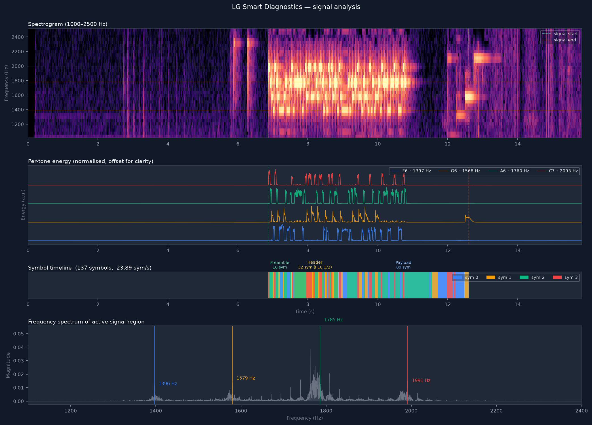

# LG Smart Diagnostics — acoustic decoder

> **Polski opis poniżej / Polish description below**

Decodes the 4-MFSK audio burst produced by **LG Smart Diagnosis** on refrigerators,
washing machines, dishwashers and other LG home appliances, and maps the payload to
known LG error codes.

> **⚠️ Single-sample caveat:** this decoder was developed and validated against a single real-world recording (LG GBB92MCB2P refrigerator, error CF).  It may not decode correctly for all appliance models or firmware versions.  If it worked for you — or didn't — please open an issue or leave a comment.  Every additional recording helps improve accuracy.



## Background

LG Smart Diagnosis transmits appliance telemetry as an acoustic signal that the official
LG ThinQ app receives by holding a smartphone microphone near the appliance.  The signal
is also used over telephone by support centres.

The modulation is **4-MFSK** (four-tone Frequency Shift Keying) with Grey coding:

| Symbol | Tone (nominal) | Grey bits |
|--------|---------------|-----------|
| 0      | F6 = 1396.91 Hz | `00` |
| 1      | G6 = 1567.98 Hz | `01` |
| 2      | A6 = 1760.00 Hz | `11` |
| 3      | C7 = 2093.00 Hz | `10` |

- Symbol rate: ~23.89 sym/s (~41.9 ms per symbol)
- Burst duration: ~7–17 s depending on appliance model
- Square-wave output from MCU → harmonic-rich signal that survives voice codecs

## Installation

```bash
# Python 3.10+
python -m venv .venv && source .venv/bin/activate
pip install -r requirements.txt

# ffmpeg is required for non-WAV input formats
# macOS:  brew install ffmpeg
# Ubuntu: apt install ffmpeg
```

## Usage

```bash
python decode_lg.py recording.m4a --auto-tune
```

Supported formats: any format handled by **ffmpeg** — `.m4a`, `.mp3`, `.ogg`, `.opus`, `.aac`, `.flac`, `.wav`, `.webm`, `.3gp`, and more. Only `.wav` works without ffmpeg installed.

To run without activating the venv each time:
```bash
.venv/bin/python decode_lg.py recording.m4a --auto-tune
```

Options:

| Flag | Description |
|------|-------------|
| `--auto-tune` | Auto-detect carrier frequencies from the recording (use if appliance is slightly off-pitch) |
| `--verbose` | Print symbol stream, bit stream, and full hex dump |
| `--onset-threshold F` | Fraction of peak energy for onset detection (default 0.05) |

### Tips for a good recording

- Start recording **before** triggering Smart Diagnosis on the appliance
- Hold the phone microphone close to the appliance speaker (usually front or bottom)
- Record until all tones stop — total signal is ~7–17 s

### Example output

The included `example_CF_fridge_GBB92MCB2P.m4a` was recorded with a smartphone voice recorder held near an LG GBB92MCB2P refrigerator.  Running the decoder on it produces:

```
Loading: fridge.m4a
Duration: 15.83 s  Sample rate: 44100 Hz
Auto-detected tones: ['1396.3', '1579.4', '1785.4', '1991.5'] Hz

Signal window : 6.86 s – 12.61 s  (duration 5.74 s)
Symbols       : 137  (5.7 s @ 23.89 sym/s)
Tones (actual): ['1396.3', '1579.4', '1785.4', '1991.5'] Hz
Symbol length : 1846 samples (41.9 ms)

CRC-8 verified frame(s) found:
  offset= 0 len=23  payload=bd bd 07 c3 8f ff ...  crc=0xbf

============================================================
DETECTED ERROR CODE(S):

  [CF]  Condenser fan
  Description : Condenser fan feedback signal <65 s during operation
  Action      : Check fan at rear/bottom for obstruction or moisture; may need service
  Confidence  : 4 / 16 bit offsets
============================================================
```

## Error codes

The decoder knows the following LG error codes:

| Code | Component | Notes |
|------|-----------|-------|
| CF | Condenser fan | Feedback signal loss |
| FF | Freezer fan | Ice/frost buildup or motor fault |
| rF | Refrigerator fan | Ice/frost buildup or motor fault |
| IF / F1 | Ice maker fan | Manual defrost usually resolves |
| dH | Defrost timeout | >1 h defrost attempt |
| FS / rS / dS | Temp sensors | Service required |
| CO / C1 / Od | Communications | Service required |
| 22 / 33 | Compressor relay | Service required |
| CF / CH | Refrigerant leak | Service required |
| Ad / dr / AS | Door motor | Service required |
| OF | Demo mode | Hold Fridge+Ice Plus 3 s to exit |

## Running tests

```bash
pip install pytest
pytest tests/ -v
```

## How it works

1. **Convert** — non-WAV files are converted to 44.1 kHz mono WAV via `ffmpeg`
2. **Tone detection** — optional auto-tune finds actual carrier frequencies by FFT peak analysis
3. **Filter bank** — four Butterworth bandpass filters (one per tone, ±80 Hz)
4. **Symbol detection** — per-symbol energy is computed for each filter; dominant filter = symbol
5. **Grey decode** — symbol → 2 bits via standard Grey mapping
6. **CRC scan** — CRC-8 (poly=0x07, init=0xFF) verified frames locate packet boundaries
7. **Error scan** — all 16 byte-alignment offsets are searched for known two-character LG display codes

## References

- LG patent [AU2010269313B2](https://patents.google.com/patent/AU2010269313B2/en) — home appliance diagnosis over acoustic/telephone link
- LG support — [Refrigerator error code list](https://www.lg.com/us/support/help-library/lg-refrigerator-error-code-list--20155159406537)
- Original reverse-engineering notes: [`kabelincho/LG-Smart-Diagnostics-modem`](https://github.com/kabelincho/LG-Smart-Diagnostics-modem) (the repo you are reading)

## Licence

MIT

---

## Polski opis

### Co to jest?

Dekoder sygnału akustycznego **LG Smart Diagnosis** — funkcji diagnostycznej wbudowanej w lodówki, pralki, zmywarki i inne urządzenia AGD marki LG.

Gdy urządzenie ma problem, funkcja Smart Diagnosis nadaje krótki sysygnał dźwiękowy (ok. 7–17 sekund) zakodowany jako 4-MFSK — cztery tony w zakresie 1400–2100 Hz przełączające się z prędkością ~24 sym/s. Oficjalnie sygnał odbiera aplikacja LG ThinQ, ale ten projekt umożliwia zdekodowanie go samodzielnie z dowolnego nagrania.

### Po co to robić?

Aplikacja LG ThinQ pokazuje tylko ogólny opis błędu. Ten dekoder wyciąga surowy kod błędu bezpośrednio z sygnału i pokazuje dokładnie co lodówka/pralka raportuje — bez rejestracji, bez chmury, bez potrzeby posiadania smartfona LG.

**Przykład z życia:** nagranie dołączone do repozytorium (`example_CF_fridge_GBB92MCB2P.m4a`) zostało zarejestrowane dyktafonem smartfona przy lodówce LG GBB92MCB2P. Dekoder wykrył kod `CF` — awaria wentylatora skraplacza (condenser fan feedback signal failure).

### Jak używać?

```bash
# 1. Zainstaluj zależności
python -m venv .venv && source .venv/bin/activate
pip install -r requirements.txt
brew install ffmpeg  # macOS

# 2. Nagraj sygnał Smart Diagnosis na telefon
#    (zacznij nagrywać PRZED naciśnięciem przycisku na urządzeniu)

# 3. Zdekoduj
python decode_lg.py nagranie.m4a --auto-tune

# 4. (opcjonalnie) Wygeneruj wykresy
python visualise_lg.py nagranie.m4a
```

### Jak działa sygnał?

| Symbol | Częstotliwość | Kod Grey |
|--------|--------------|----------|
| 0 | F6 = 1396.91 Hz | `00` |
| 1 | G6 = 1567.98 Hz | `01` |
| 2 | A6 = 1760.00 Hz | `11` |
| 3 | C7 = 2093.00 Hz | `10` |

Modulacja: 4-MFSK, kodowanie Grey, szybkość symboli ~23.89 sym/s, jeden symbol trwa ~41.9 ms. Urządzenia LG generują sygnał jako fala kwadratowa z MCU (bogate w harmoniczne — to celowe, bo kodeki głosowe lepiej go przepuszczają). Strukturę ramki opisuje patent LG [AU2010269313B2](https://patents.google.com/patent/AU2010269313B2/en).

